<picture><source media="(prefers-color-scheme: dark)" srcset="assets/hero-dark.svg"></picture>

<picture><source media="(prefers-color-scheme: dark)" srcset="assets/social-l-dark.svg"></picture><a href="https://github.com/Alberviz"><picture><source media="(prefers-color-scheme: dark)" srcset="assets/social-1-dark.svg"></picture></a><a href="https://alberviz.github.io"><picture><source media="(prefers-color-scheme: dark)" srcset="assets/social-2-dark.svg"></picture></a><picture><source media="(prefers-color-scheme: dark)" srcset="assets/social-r-dark.svg"></picture>

<picture><source media="(prefers-color-scheme: dark)" srcset="assets/about-dark.svg"></picture>

<a href="https://github.com/Alberviz/LinuxRicing"><picture><source media="(prefers-color-scheme: dark)" srcset="assets/project-linuxricing-dark.svg"></picture></a>&nbsp;<a href="https://github.com/Alberviz/JoseoKings-Hackyeah"><picture><source media="(prefers-color-scheme: dark)" srcset="assets/project-joseokings-hackyeah-dark.svg"></picture></a>

<a href="https://github.com/Alberviz/gts2-mando"><picture><source media="(prefers-color-scheme: dark)" srcset="assets/project-gts2-mando-dark.svg"></picture></a>&nbsp;<a href="https://github.com/Alberviz/Alberviz.github.io"><picture><source media="(prefers-color-scheme: dark)" srcset="assets/project-alberviz-github-io-dark.svg"></picture></a>

<picture><source media="(prefers-color-scheme: dark)" srcset="assets/stack-dark.svg"></picture>

<picture><source media="(prefers-color-scheme: dark)" srcset="assets/wave-dark.svg"></picture>

<a href="https://metawka.github.io/expressive-profile/?from=Alberviz"><picture><source media="(prefers-color-scheme: dark)" srcset="assets/credit-dark.svg"></picture></a>

